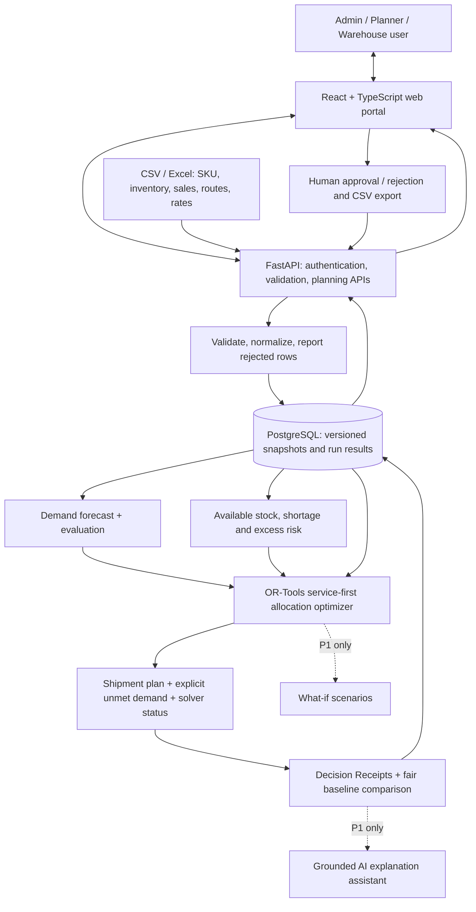
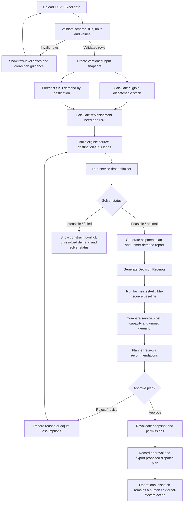

Team codex 
StockWise
## Product Requirements Document | Triwizathon — Problem Statement 2

**Tagline:** The right stock. At the right place. Before it is too late.  
**Version:** 2.1 — Round 1 rubric-verified submission draft  
**Status:** Proposed product and implementation plan; no results are claimed as achieved  
**Category:** FMCG distribution intelligence and inventory optimization

---

## 1. Executive Summary

Imagine two stores selling the same product. One loses customers because its shelves are empty. A few hundred kilometres away, another location is holding boxes it may never sell. The company has stock—but not necessarily where it is needed.

This is the problem **StockWise** is designed to solve.

StockWise is a decision-support platform that converts scattered inventory, sales, and transport data into **practical distribution recommendations**. Instead of simply showing a stockout warning or forecasting next week's sales, it answers the question a distribution planner actually faces:

> **Which product should we send, in what quantity, from which warehouse, to which destination, by when—and why is that the best feasible choice?**

The proposed engine combines demand forecasts with actual dispatchable stock, permitted distribution routes, delivery lead times, transport rates, and capacity limits. A constrained optimizer recommends allocations and reports demand that still cannot be covered. Each recommendation comes with a plain-language **Decision Receipt** describing the evidence, trade-offs, and constraints behind it.

The hackathon MVP will support importing CSV/Excel data, generating a demand estimate and risk summary, optimizing a seven-day distribution plan, comparing it fairly with a simple baseline, and reviewing/exporting suggested shipments. Expiry-aware planning, disruption simulations, and a grounded conversational assistant are prioritized as follow-on features.

The team may use **clearly labelled synthetic data** where real FMCG operational data is unavailable. We will demonstrate projected improvements only when calculated on reproducible test cases, never present simulated savings as verified business outcomes, and keep a human decision-maker in control of dispatch approval.

## 2. Problem Definition and Real-World Impact

FMCG distribution is a daily balancing act. Demand varies between neighbourhoods and seasons; products move between warehouses, distributors, and shops; vehicles and storage space are limited; and some inventory has a rapidly approaching expiry date.

A planner may have to make several decisions at once: a store needs detergent tomorrow, the nearest warehouse's available stock is already reserved, a second warehouse has stock but an expensive route, and another store is facing a more serious shortage. A spreadsheet may show each part of this situation but rarely reveals the best feasible network-wide response.

### 2.1 Where today's workflow breaks down

| Operational problem | What people experience | Business consequence |
|---|---|---|
| Inventory is fragmented | On-hand, reserved, damaged, and in-transit quantities live in different files | Decisions based on stock that cannot actually be sent |
| Demand differs by region | The same SKU sells at different rates across destinations | Stockouts in one place and surplus elsewhere |
| Sources are chosen in isolation | The nearest warehouse looks attractive until capacity or lead time is checked | Extra cost, delayed arrivals, or invalid shipments |
| Perishable batches are overlooked | A batch is moved without considering remaining shelf life | Avoidable expiry risk and write-offs |
| Trade-offs are hidden | A plan appears cheap without showing how much demand it leaves unserved | Lower service levels disguised as cost efficiency |

**Illustrative case — synthetic, not an observed company result.** A distributor expects to sell **120 units** of SKU A over the next seven days. It has **80 eligible units** and no confirmed incoming delivery, leaving a **40-unit demand gap**. Warehouse East has no uncommitted stock. Warehouse West has 100 units, but takes longer and costs more to serve the distributor. The planner needs to know whether West can deliver before the stockout, whether another eligible source can share the load, and whether the extra cost is justified by the demand protected. StockWise makes those decisions comparable and traceable.

The original reference document also cites an industry dashboard from the Consumer Brands Association for consumer-packaged-goods out-of-stock context. Those figures are **not** a measurement of Indian FMCG operations or this proposed solution; consequently, our evaluation will rely on transparent sample-network metrics rather than applying an industry average to every company. Reference: [Consumer Brands Association — Supply Chain Dashboard](https://consumerbrandsassociation.org/supply-chain/supply-chain-dashboard/).

### 2.2 Scope and boundaries

**In scope:** finished products moving across eligible links among central warehouses, regional warehouses, distributor locations, and retail destinations; stock and sales imports; demand estimates; risk identification; constrained allocation; estimated transport costs; explanation and approval.

**Representative network:** plant → central warehouse → regional warehouse → distributor → retailer. Configured direct routes may skip intermediate steps.

**Out of scope for the MVP:** raw-material procurement, automated purchase orders, real dispatch execution, real-time GPS, live ERP/WMS/POS integrations, and nationwide vehicle routing. The prototype is not a replacement for enterprise supply-chain systems.

### 2.3 Product outcomes

The system must help planners **protect service**, **use existing stock more intelligently**, **understand the real cost of moving it**, and **see what remains unresolved**. Its goal is not to minimize transport cost at any price; it is to find a defensible balance between service, cost, feasibility, and—when sufficient information exists—waste risk.

## 3. Who We Are Building For

### 3.1 Distribution planner — primary decision-maker

*“I know there is inventory somewhere in our network. I need to know where I can get it from without creating another shortage.”*

The planner compares forecast demand, available stock, and source options. Success means receiving a credible shipment plan, not another collection of disconnected charts.

### 3.2 Warehouse manager — feasibility owner

*“Do not ask me to dispatch 500 cases if 200 are reserved and 50 are blocked.”*

The warehouse manager needs dispatchable quantities, incoming commitments, dispatch capacity, and an approval-ready pick/transfer list.

### 3.3 Distributor manager — customer availability owner

*“Tell me which products I am likely to run out of, and whether help will arrive in time.”*

The distributor manager needs stock-cover estimates, expected arrival dates, and a clear view of unfulfilled needs.

### 3.4 Logistics coordinator — transport reality check

*“The shortest route is not always the cheapest or the fastest possible delivery.”*

The logistics coordinator checks lane eligibility, transport rates, lead times, and declared capacity assumptions.

### 3.5 Company administrator — data and governance owner

*“If the SKU codes and quantities are wrong, even the smartest plan will be wrong.”*

The administrator manages imports, product/location definitions, planning rules, and user permissions.

## 4. Core User Journeys

**Journey A — From files to trustworthy inputs.** An admin uploads product, inventory, sales, and route files. The system identifies unknown SKUs, duplicate keys, negative quantities, inconsistent units, and missing fields. It accepts clean rows, isolates rejected rows with reasons, and gives the admin a visible data-quality summary before a plan can be run.

**Journey B — From shortage to shipment recommendation.** A planner selects a seven-day horizon, reviews forecast demand and stockout risk, and chooses **Generate Plan**. The optimizer checks each eligible source against available stock, delivery timing, and capacity, then returns a shipment list with quantities, costs, reasons, and any remaining unmet demand. An authorized manager can approve or reject the proposal; approval **does not** dispatch vehicles.

**Journey C — Understand one difficult choice.** A planner opens a high-risk destination and sees why the engine preferred Warehouse West over Warehouse East—for example, East has no unreserved stock even though it is closer. The user can inspect the relevant constraints rather than accept an unexplained AI recommendation.

**Journey D — Prepare for disruption (P1).** The planner copies a plan, increases demand by 20%, or temporarily disables one route. StockWise recalculates and compares fill rate, estimated cost, unmet demand, and binding constraints. This is a modeled *what-if*, not a prediction that a disruption will certainly happen.

## 5. Functional Requirements and Prioritization

**Priority rule:** P0 is the smallest end-to-end product that proves distribution optimization works. P1 makes the product more useful and distinctive after the core is reliable. P2 is a future integration roadmap, not an implied hackathon promise.

### 5.1 P0 — Must have for a functional MVP

| ID | Capability | Required behavior and acceptance test |
|---|---|---|
| P0-01 | Data import and validation | Upload CSV/Excel templates for products, inventory, sales, locations, and permitted lanes; reject invalid rows with specific reasons; do not silently coerce bad values |
| P0-02 | Inventory visibility | Show on-hand, reserved, blocked, confirmed incoming, and currently dispatchable stock by SKU/location without double-counting in-transit units |
| P0-03 | Baseline demand forecast | Forecast demand by SKU/destination for a selected horizon using moving average or seasonal-naive methods; identify model, horizon, and limited-data cases |
| P0-04 | Stock risk and replenishment gap | Report shortage risk, stock-cover days, overstock against a configured target, and positive unmet need; show assumptions behind risk levels |
| P0-05 | Constraint-aware optimization | Choose quantities and eligible source/destination lanes; never exceed dispatchable stock, permitted routes, or configured capacities |
| P0-06 | Lead-time and cost evaluation | Exclude arrivals that miss the required demand window under the initial single-period model; estimate cost from documented rates, not straight-line distance alone |
| P0-07 | Actionable plan and Decision Receipt | Every recommendation includes SKU, source, destination, quantity, anticipated arrival, estimated cost, priority, and evidence-based explanation; show unresolved shortfall |
| P0-08 | Fair baseline and export | Compare against a deterministic nearest-eligible-source policy using identical inputs and constraints; export proposed movements and metrics |
| P0-09 | Human review and role-based views | Present admin, planning, and warehouse/logistics workflows over one backend; authorized user records approval or rejection; no physical dispatch execution |

**P0 release gate:** A complete *import → validate → forecast → optimize → explain → compare → export* workflow must run on the documented sample dataset. Invalid allocations or hidden unmet demand are release-blocking defects.

### 5.2 P1 — Should have after core feasibility is proven

| ID | Capability | Specific value |
|---|---|---|
| P1-01 | Batch-level expiry / FEFO | Exclude expired batches, prefer earlier-expiring eligible stock where feasible, and flag quantities unlikely to sell before expiry |
| P1-02 | What-if simulator | Re-run with changed demand, available stock, lane cost, lead time, or route capacity; compare results with the original plan |
| P1-03 | Explainable AI assistant | Answer natural-language questions using saved forecasts, constraints, and solution records only; abstain where inputs are missing |
| P1-04 | Network visualization | Show configured nodes and recommended flows; use a schematic when actual coordinates are absent |
| P1-05 | Replenishment guidance | Display reorder points, safety stock, and suggested reorder quantities under stated assumptions |
| P1-06 | Dispatch priority ranking | Make urgency, replenishment lead time, and service-level policy visible and configurable |
| P1-07 | Waste and holding cost analysis | Evaluate expiry-risk transfers and multi-objective trade-offs only when batch data and defensible cost assumptions exist |

### 5.3 P2 — Nice to have / post-hackathon

ERP/WMS/POS integration, barcode or QR stock updates, live shipment tracking, advanced vehicle routing, automatic model retraining with monitored performance, enterprise-grade audit workflows, and authorized dispatch execution via integrated operational systems.

**Additional implementation detail carried forward from the technical reference**

- **Forecasting:** begin with moving-average or seasonal-naive baselines; record forecast method, horizon, and data limitations. Evaluate more complex models only against a time-based holdout and only if they outperform the baseline.
- **Shortage investigation:** show the affected SKU/destination, forecast horizon, eligible stock, confirmed receipts, earliest feasible replenishment, source alternatives, and remaining unmet demand.
- **Scenario simulation (P1):** allow controlled changes to demand, inventory, route availability, transport rates, lead time, or capacity. Store the changed assumptions and compare the scenario against its parent plan.
- **Conversational assistant (P1):** ground answers in saved forecasts, solver results, and Decision Receipts. It must abstain when required evidence is missing and must not invent stock totals, costs, or constraint outcomes.
- **Network visualization (P1):** show configured locations and proposed flows; use a schematic rather than a geographic map when trustworthy coordinates are unavailable.

## 6. Product Experience: Three Role-Based Portals

All three portals use **one website, one shared database, and one planning engine**. They are permissioned views, not separate software products.

**Company Admin Portal:** upload and clean data; manage SKUs, warehouses, routes, capacities, costs, and users; see validation failures and input versioning.

**Distribution Intelligence Portal:** review predicted demand, shortage and overstock signals, run the optimizer, compare plans, inspect Decision Receipts, and—at P1—run scenarios or ask grounded questions.

**Warehouse & Logistics Portal:** inspect currently dispatchable stock, proposed dispatch quantities and timing, constraints, and approval states; record non-live demo statuses when appropriate.

**Core screens:** Import Centre → Inventory Overview → Risk & Demand → Optimize Plan → Recommendation Details → Baseline Comparison → Approval & Export. The interface should always distinguish **actual inputs, forecasts, simulated outcomes, and missing data**.

## 7. Technical Architecture and Engineering Approach

### 7.1 High-level architecture and end-to-end data flow

The product is a **single web application with three role-based views**, backed by one API and one planning database. The forecast produces an estimate; the optimizer—not a chatbot—decides which quantities can move within the declared constraints.

**Proposed stack:** React + TypeScript + Tailwind CSS (frontend); Python + FastAPI (API and calculations); Pandas/NumPy (file processing); simple moving-average/seasonal-naive demand models first, with scikit-learn models considered only if validated; Google OR-Tools (linear or mixed-integer optimization); PostgreSQL (structured data and immutable planning snapshots). A lightweight network visualization is optional. If included, a language model **explains** structured results and cannot change solver decisions or invent inventory totals.

**How one planning request flows through the system:**

1. **Import and trust:** The administrator submits datasets. FastAPI checks schemas, identifiers, quantities, measurement units, and route references. Invalid rows are returned with row-level reasons; only validated data enters a versioned snapshot.
2. **Understand demand:** A planner selects the inventory snapshot and seven-day horizon. The forecast service estimates SKU-level destination demand and records its method and evaluation limitations. The inventory engine computes dispatchable supply, confirmed receipts, and shortage risk without double counting.
3. **Find a feasible plan:** OR-Tools receives candidate lanes, eligible supply, replenishment needs, costs, arrival cutoffs, and capacities. It first minimizes weighted unmet demand and then minimizes estimated transport costs without worsening that service optimum.
4. **Explain and compare:** The backend stores solver status, shipments, unmet demand, and constraint evidence. A deterministic baseline runs on the **same input snapshot and feasibility rules**. The interface presents both plans with Decision Receipts.
5. **Keep a human in control:** An authorized manager reviews, approves, or rejects the proposed plan. The API checks authorization and whether its snapshot is stale. Approval only records a proposed decision—it never dispatches a vehicle or silently consumes stock.

**Failure handling:** Bad uploads yield validation details, insufficient history triggers a labelled simple forecast or missing-data state, and infeasible/failed solves return a clear status and unresolved shortage rather than fabricated shipments. For the hackathon, requests may be synchronous within a measured limit; a run ID plus status endpoint can replace this if execution becomes longer.

#### End-to-end workflow diagram

The workflow must preserve a visible failure path. Invalid input, missing data, infeasible constraints, or a failed solver must never be converted into fabricated shipment recommendations. Approval records a decision; it does not itself dispatch stock.

### 7.2 Data model

| Entity | Key fields |
|---|---|
| `sku` | `sku_id`, description, unit, case_pack, optional shelf_life |
| `location` | `location_id`, location_type, region, optional coordinates |
| `inventory_snapshot` | snapshot_id, sku_id, location_id, on_hand, reserved, blocked, as_of_date |
| `confirmed_receipt` | receipt_id, sku_id, destination_id, quantity, ETA, state; one receipt counted once |
| `sales_history` | sku_id, destination_id, sales_date, quantity |
| `route` | from_id, to_id, sku_eligibility, lead_time_days, cost_rate, optional capacity |
| `batch` (P1) | batch_id, sku_id, location_id, quantity, expiry_date |
| `forecast` | run_id, sku_id, destination_id, horizon, quantity, method, evaluation_notes |
| `plan_run` | run_id, input_snapshot_id, horizon, parameters_json, solver_status, timestamps |
| `shipment_recommendation` | run_id, sku_id, source_id, destination_id, quantity, ETA, estimated_cost, reason_codes |
| `plan_approval` | plan_id, authorized_user_id, decision, timestamp |
| `scenario` (P1) | parent_run_id, changed_assumptions, result_run_id |

Store consistent identifiers and measurement units. Every plan should refer to an immutable input snapshot, model/solver parameters, and cost assumptions to make it reproducible.

### 7.3 Proposed API contracts

| Endpoint | Purpose |
|---|---|
| `POST /api/imports/{dataset}` | Validate and persist approved records; return accepted/rejected row counts and errors |
| `POST /api/forecasts/run` | Create demand forecast for the selected snapshot and horizon |
| `GET /api/risks?run_id=...` | Return stockout/overstock diagnostics |
| `POST /api/optimization/run` | Start optimization with snapshot, horizon, and explicit constraints |
| `GET /api/plans/{plan_id}` | Return solver status, shipments, Decision Receipts, cost and service metrics |
| `GET /api/plans/{plan_id}/comparison` | Return feasibility-aware optimized-vs-baseline metrics |
| `POST /api/plans/{plan_id}/approval` | Authorized approve/reject action; never dispatches physical stock |
| `POST /api/scenarios/run` (P1) | Recalculate from parent plan with modified assumptions |

Imports and optimization requests must be validated; authenticated roles restrict administration and approval; large jobs may return a run ID to be polled. Proposed endpoints are specifications, **not a claim of deployed functionality**.

**API contract example (illustrative, not a live response):** `POST /api/optimization/run` accepts `snapshot_id`, `horizon_days`, `priority_weights`, and `capacity_policy`. It returns `run_id`, `status` (`completed`, `infeasible`, or `failed`), `input_snapshot_id`, `shipments`, `unmet_demand_by_sku_destination`, `estimated_transport_cost`, `solver_runtime_ms`, and `assumption_flags` (or a run ID for polling). Each shipment includes `reason_codes` and `arrival_by_cutoff`. `400` means invalid input; `403` means an unauthorized action; `409` means a stale snapshot or conflicting approval. No endpoint may authorize allocations from a stale stock position without revalidation.

**Minimum access and integrity controls (P0):** authenticate users, enforce role checks on the API (not only in the UI), limit upload size and file types, validate every imported row, and retain the snapshot ID and approver in the audit record. Never embed raw operational files or secrets in prompts to the optional assistant.

**Minimum optimization response contract (illustrative, not a live response):**

A request should identify `snapshot_id`, `horizon_days`, documented priority settings, and applicable capacity policy. The response should include `run_id`, `status` (`completed`, `infeasible`, or `failed`), `input_snapshot_id`, shipment recommendations, unmet demand by SKU/destination, estimated transport cost, solver runtime, and assumption/data-quality flags. Each shipment should include source, destination, SKU, quantity, estimated arrival, cost, and reason codes. Invalid input should return a validation error; unauthorized actions should be rejected; stale snapshots or conflicting approvals should require revalidation. Long-running jobs may return a run ID and status endpoint.

This is a proposed contract, not a claim that these endpoints are already deployed.

### 7.4 Inventory accounting: available is not the same as on-hand

For source location \(i\), SKU \(k\), the current dispatchable amount is:

\[
A_{ik}=\max(0,\ OH_{ik}-R_{ik}-H_{ik})
\]

Here \(OH\) is on-hand stock, \(R\) is reserved/committed stock, and \(H\) is blocked or unusable stock. Incoming or in-transit units are **not** treated as currently dispatchable. For future-dated plans, confirmed receipts can be added **only after their ETA**, exactly once, with stock conservation across locations. The initial MVP solves a **single seven-day planning period** using the snapshot of dispatchable supply, not a falsely precise day-by-day warehouse simulation.

For destination \(j\) and SKU \(k\), define demand \(D_{jk}\) for the planning period, usable current destination stock \(S_{jk}\), and confirmed receipts arriving before the demand cutoff \(I_{jk}\). Let service demand remaining after those units be:

\[
G_{jk}=\max(0,\ D_{jk}-S_{jk}-I_{jk})
\]

With configured ending safety-stock target \(SS_{jk}\), define the **replenishment target** separately:

\[
N_{jk}=\max(0,\ D_{jk}+SS_{jk}-S_{jk}-I_{jk})
\]

Here \(G\) is the service-related uncovered demand, while \(N\) also allows replenishment toward safety stock. They are different metrics: filling safety stock must **not** be reported as fulfilling customer demand. Confirmed receipts are counted only once and only if their arrival qualifies for the relevant cutoff.

**Additional inventory-position rules from the technical specification**

For future-dated planning, projected available stock may include confirmed receipts only after their ETA, and only once. Where the data model tracks prior commitments, use a consistent convention such as:

\[
A_{i,k}(t)=\max(0,\ OH_{i,k}-R_{i,k}-H_{i,k}-C^{prior}_{i,k}+I^{\leq t}_{i,k})
\]

Here \(C^{prior}\) is stock committed to other plans and \(I^{\leq t}\) is confirmed incoming supply expected by time \(t\). Do not subtract the same commitment twice. Reconcile inventory events so in-transit units are not counted at both source and destination. For the initial MVP, use the declared single-period seven-day planning model; do not imply a full day-by-day multi-period simulation unless time-indexed inventory balances are implemented.

For destination \(j\) and SKU \(k\), retain the distinction between service demand remaining and the replenishment target:

\[
G_{j,k}=\max(0,D^T_{j,k}-S^{eligible}_{j,k}-I^{\leq T}_{j,k})
\]

\[
N_{j,k}=\max(0,D^T_{j,k}+SS_{j,k}-S^{eligible}_{j,k}-I^{\leq T}_{j,k})
\]

\(G\) is uncovered demand; \(N\) includes any configured safety-stock target. Replenishing safety stock must not be counted as fulfilling customer demand.

### 7.5 Optimization model — concrete, testable, and constrained

The **P0 single-period model** assumes each candidate lane has one configured cost per unit, an ETA that qualifies or disqualifies it for the horizon, and a quantity limit in comparable product units. Batch-specific expiry and full vehicle routing are P1/P2 additions.

**Variables**

- \(x_{ijk}\ge0\): quantity of SKU \(k\) shipped from warehouse \(i\) to destination \(j\).
- \(u_{jk}\ge0\): uncovered service demand \(G_{jk}\) remaining after qualifying transfers.
- Optional integer/case-pack variables when SKU quantities must ship in whole cases.

**Primary optimization objective:** protect demand service before minimizing shipment cost. To prevent an artificially cheap zero-shipment solution, use a **lexicographic objective**: (1) minimize weighted unmet demand (with documented destination priority weights), then (2) minimize transport cost among solutions with the same optimal service score. An explicit minimum service-level constraint may also be configured and must be reported infeasible if unattainable.

\[
\text{Stage 1: }\min \sum_{j,k} p_{jk}u_{jk}
\qquad
\text{Stage 2: }\min\sum_{i,j,k}c_{ijk}x_{ijk}\text{ subject to Stage 1 optimality}
\]

**Constraints**

1. **Source inventory:** \(\sum_j x_{ijk}\le A_{ik}\) for every source/SKU.
2. **Replenishment ceiling:** \(\sum_i x_{ijk}\le N_{jk}\). Do not send unwanted surplus to game the model.
3. **Service shortfall:** \(u_{jk}\ge G_{jk}-\sum_i x_{ijk}\), and \(u_{jk}\ge0\). A shipment can contribute toward demand service only if it arrives by the relevant cutoff; safety-stock-only shipments do not count as additional sales.
4. **Eligible lanes:** \(x_{ijk}=0\) for forbidden source/destination/SKU pairs.
5. **ETA:** exclude lane candidates whose delivery would miss the modeled required date.
6. **Dispatch/route capacity:** apply declared capacities with appropriate unit conversion; if vehicle details are absent, do **not** claim vehicle-loading feasibility.
7. **Pack sizes:** where applicable, shipment quantities must be whole case-pack multiples.
8. **Stock conservation:** quantities cannot be committed to multiple approved recommendations from the same input snapshot; overlapping run approvals require a fresh inventory check.

**P1 expiry extension:** add batch index \(b\), expiry eligibility, FEFO preference, and modeled expiry-risk quantity, with supporting data and no speculative waste claim. For multi-period delivery, implement time-indexed inventory balances rather than treating a future receipt as present stock.

If a constraint cannot be evaluated because required data is missing, the engine must reject that candidate or disclose its assumption. It must not silently claim complete feasibility.

**Additional constraint coverage and P1 expiry extension**

The implementation must apply the following rules where the corresponding data is supplied:

- **Transport capacity:** if vehicle/shipment-group capacity is modelled, total shipment volume or weight must not exceed the configured limit. If the MVP does not model vehicles, do not claim vehicle-loading feasibility.
- **Inventory-flow conservation:** ending inventory must reconcile beginning eligible stock, confirmed receipts, inbound/outbound transfers, and modeled consumption. The same units cannot exist at two locations simultaneously.
- **Case-pack multiples:** when a SKU has a configured case pack, shipment quantity must be an integer multiple of that pack; otherwise the unit policy must be stated.
- **Service-level targets:** if a minimum fulfilment target is configured and cannot be met, show the shortfall or infeasibility rather than silently relaxing the target.
- **Batch-level expiry (P1):** when batch data exists, extend \(x_{i,j,k}\) to \(x_{i,j,k,b}\), exclude expired batches, and require arrival before expiry. Prefer First-Expired-First-Out (FEFO) among otherwise eligible batches, subject to demand and capacity.
- **Expiry-risk quantity (P1):** a variable \(w_{\ell,k,b}\geq0\) may represent estimated quantity at risk of remaining unsold at expiry. Any expiry penalty or holding/waste cost must be configurable, documented, and enabled only when batch, shelf-life, and demand inputs support the estimate. If these inputs are absent, disable the expiry objective and label the limitation; do not invent a universal waste rate.
- **Optional lane activation:** a binary \(z_{i,j,k}\) may be used only when fixed lane costs or minimum shipment quantities are explicitly modelled.

The service-first lexicographic objective remains the primary optimization policy: first minimize weighted unmet demand, then minimize transport cost among solutions with the same optimal service score. Expiry-aware trade-offs are an explicitly scoped extension and must not silently replace the service-first priority.

### 7.6 A fair baseline, not a weak straw man

The comparison policy is **nearest eligible warehouse, then next-nearest**, allocating limited source stock across competing destinations proportionally to uncovered demand. It applies the **same stock, lane, cutoff, and capacity restrictions**, with deterministic SKU/destination tie-breakers. Distance is used only as a ranking proxy; both plans are costed using identical configured transport rates. If the heuristic cannot find a feasible allocation despite available options, that failure is reported—not quietly removed from the comparison.

The engine compares the plans on **fulfilled demand, unmet demand, estimated transport cost, utilized stock, constraint violations, and time to compute**. A lower-cost plan that serves fewer customers must show that trade-off prominently; no unqualified “X% savings” claim is allowed.

### 7.7 Decision Receipts: our key product differentiator

Every allocation produces a compact, reproducible explanation attached to the calculation—not an LLM-generated guess:

> **Proposed: Send 40 units of SKU A from Warehouse West to Distributor North.**  
> Demand gap: 40 units across the selected horizon. East excluded: 0 eligible dispatchable units. West: 100 eligible units; approved lane and delivery window available. Quantity allocated: 40; estimated transport cost: calculated from the configured lane rate. Remaining service gap: 0 units **if the shipment arrives as modeled**.

Decision Receipts contain numeric evidence, alternative-source rejection reason codes, input snapshot version, applied constraint set, and forecast method. The P1 assistant may translate those records into conversational answers but cannot change the underlying results.

### 7.8 Risk scoring assumptions

Compute indicative stock cover using eligible destination stock plus confirmed receipts by cutoff, divided by forecast daily demand. If forecast daily demand is zero, report **No Forecast Demand** rather than divide by zero. If data is missing, report **Insufficient Data**.

The demo uses *configurable*, not universal, thresholds: **Critical** when projected stockout precedes earliest feasible replenishment; **High** when cover is at or below lead time plus safety buffer; **Medium** when cover is at most twice that threshold; **Low** otherwise. For excess stock, flag projected ending inventory more than **25% above configured target** and at least one case pack when case-pack units exist. Persist thresholds with every run.

**Reproducible demo dataset specification**

Use 3 source warehouses, 12 SKUs, 30 destination locations (a mix of distributor warehouses and retail destinations), 90 days of daily demand/sales history per SKU-destination pair, and a seven-day initial planning horizon. This is up to 360 SKU-destination time series before missing observations. Include route eligibility, cost rates, lead times, and inventory snapshots with on-hand, reserved, blocked, and confirmed incoming quantities. Add batch/expiry records only if demonstrating the P1 expiry feature. Label the dataset synthetic unless it comes from a documented real source. Any runtime claim must name the test environment and dataset size.

## 8. Innovation and Differentiation

Most basic inventory tools answer **“What do we have?”** Forecasting tools answer **“What might sell?”** StockWise connects both to answer **“What should we move next, given what is actually possible?”**

Its proposed value is not a claim to a novel forecasting algorithm. It is the combination of:

1. **Constraint-first recommendations:** reserved or blocked inventory, ineligible routes, missed delivery cutoffs, and capacity limits cannot be overlooked.
2. **Service-first, cost-aware allocation:** a cheaper plan is not automatically a better plan if it leaves avoidable demand unserved.
3. **Decision Receipts:** each proposed transfer shows the evidence and rejected alternatives behind the choice.
4. **Replayable planning:** input snapshots, assumptions, and baselines make decisions and improvements auditable.
5. **Resilience testing (P1):** planners can rehearse shortages and route disruptions before approving an actual plan.

This gives the proposal an understandable competitive distinction while staying achievable within a hackathon. The differentiator must be proved through correct outputs and comparisons, not merely a visually impressive dashboard.

## 9. Measurable Success Metrics and Acceptance Criteria

All figures below are **targets for future validation**, not achieved performance.

| Dimension | MVP acceptance target | Evidence required |
|---|---|---|
| Data quality | 100% of intentionally invalid test records flagged with row-level reasons | Import test suite and sample failure file |
| Inventory correctness | **Zero** source-stock overallocations | Automated conservation tests |
| Network feasibility | **Zero** accepted allocations on forbidden lanes, late candidate lanes, or above modeled capacity | Constraint unit/integration tests |
| Recommendation completeness | **100%** have SKU, source, destination, quantity, ETA or limitation, cost or limitation, and reason | Plan schema test |
| Service transparency | Every run reports fulfilled and unmet demand with the denominator stated | Plan metrics and baseline comparison |
| Forecast transparency | MAE and, where valid, WAPE versus a simple baseline on chronological holdout data | Reproducible evaluation table |
| Cost accuracy | **100%** of costed movements trace to a declared rate or formula | Rate reference per shipment |
| Runtime | Target **≤10 seconds** for the documented demo optimization with up to **500 candidate SKU–source–destination lanes**, excluding upload/network latency | Logged machine specs, model settings, and observed runtime |
| Explainability | **100%** of shipments include a Decision Receipt or a clearly stated missing-data limitation | Structured reason-code checks |
| User workflow | A reviewer can import, optimize, inspect, compare, approve/reject, and export without needing a developer | End-to-end acceptance run |

**Forecast metrics:** MAE = average absolute forecast error; WAPE = sum of absolute errors divided by sum of actual demand, expressed as a percentage. WAPE is not useful when total actual demand is zero or extremely small; report MAE or an appropriate alternative instead. Train and evaluate chronologically—never expose future observations to the forecast.

**Distribution metrics:** fill rate = (demand served from eligible current stock, qualifying receipts, and timely transfers) / total modeled demand. Also report the total units unserved, transport cost, ending stock, candidate-lane exclusions, and solver status. **Projected** results derived from synthetic data must be labelled *simulated*.

### 9.1 KPI measurement plan and decision thresholds

| KPI | Exact measurement | Round 1 acceptance rule |
|---|---|---|
| Fill rate | `fulfilled customer-demand units / modeled customer-demand units × 100`; if denominator is zero, show `N/A` | Show baseline and optimized results with identical demand, cutoffs, and initial stock; **do not claim improved service without a positive measured difference** |
| Unmet demand | `sum(max(0, customer demand − qualifying existing stock − on-time receipts − on-time transfers))` by SKU/destination | Report all positive gaps, including when the optimizer cannot cover them |
| Transport cost difference | `optimized transport cost − baseline transport cost`, same currency, rate table, and service context | State positive/negative change; label cost reduction only where service is unchanged or improved, or disclose a service trade-off |
| Relative cost change | `(baseline cost − optimized cost) / baseline cost × 100`; `N/A` when baseline cost is zero | Show numerator, denominator, and whether both plans meet the same service target |
| Forecast error | `MAE = mean(abs(actual − predicted))`; `WAPE = sum(abs(error)) / sum(actual) × 100` where denominator is meaningful | Evaluate on a chronological holdout; disclose whether the tested forecast beats the simple baseline |
| Data validation and feasibility | `rejected invalid test records / seeded invalid test records`; separate stock/route/capacity/ETA violation counts | **100%** seeded invalid cases flagged and **zero** modeled hard-constraint violations in accepted plans |
| Response and solve time | Capture `optimizer_start` to `optimizer_end` for the saved input snapshot; report median and slowest of five local test runs | **≤10 seconds target per optimization** on the declared test hardware and at most 500 eligible candidates; publish observed measurements |
| Explainability coverage | `shipments with complete evidence receipt / all proposed shipments × 100` | **100%** receipts identifying snapshot, constraint reasoning, source, quantity, and cost basis |

**Evaluation protocol:** Use one fixed, documented synthetic seed and snapshot for both plans; run at least the shortage, reserved-stock, restricted-route, and limited-capacity cases. Save the input files, forecast holdout split, solver configuration, test hardware, plan outputs, and actual measured results. The dataset contains up to **1,080 possible source–destination–SKU combinations** (3 × 30 × 12); the ≤500-candidate runtime target applies to an explicitly filtered eligible subset, not to all combinations. Do not substitute invented “expected savings” for measured results. These values are **proposed acceptance targets**, not proof of current performance.

## 10. Data Strategy, Assumptions, and Test Scenarios

The initial test network is a **synthetic, reproducible Indian-market-inspired network**:

| Parameter | Proposed demo setup |
|---|---|
| Source warehouses | 3 |
| SKUs | 12 |
| Distributor/retail destinations | 30 |
| History | 90 days of daily sales per SKU/destination, with documented missing-value handling |
| Planning horizon | 7 days |
| Time series | Up to 360 SKU–destination series |
| Supply data | On-hand, reserved, blocked, confirmed receipts, and route permissions |
| Delivery data | Configured transport rate, ETA/lead time, and optionally dispatch/route capacity |
| Expiry data | Optional subset with real-looking but **synthetic** batch dates for P1 testing |

Sample cases should include: (a) demand higher than local supply; (b) two sources competing to serve one destination; (c) a nearest warehouse whose stock is reserved; (d) a forbidden or too-slow lane; (e) several destinations competing for one limited source; (f) a complete supply shortage with explicit unmet demand; and (g) an expiry-risk case only if P1 is implemented.

**Assumptions to publish alongside data:** units and case sizes, inventory snapshot date, receipt ETA trust level, demand calculation horizon, missing-data rules, transport-rate currency and basis, safety buffers, capacity units, priority weights, and whether an estimated arrival is treated as on-time. Travel distance is not a substitute for carrier pricing. Stockout-aware demand estimation is limited if sales history does not record lost sales.

## 11. Delivery Plan and Feasibility

| Milestone | Build focus | Exit criterion |
|---|---|---|
| M1 — Data foundation | CSV templates, normalizer, schema validations, seed dataset, inventory views | Clean file imports; errors identify bad rows |
| M2 — Forecast and risk | Transparent baseline forecast, cover/gap calculations, time-split error measurement | Each SKU/destination has a forecast or limitation flag |
| M3 — Optimization engine | Stock/route/ETA/capacity rules, service-first solve, shipment output | Automated tests reject impossible allocations |
| M4 — Decision workflow | Three permissioned views, Decision Receipts, fair baseline, comparison, export, approval status | Full P0 user journey works on sample data |
| M5 — Stretch features | Expiry batches, scenario simulator, grounded assistant, network view | Only attempted when M1–M4 are reliable |

**Scope control:** prioritize correctness of the allocation engine and explainability over advanced model complexity. If the solver or dataset is unreliable, the product falls back to a transparent baseline and clearly reports limitations; it does not fabricate an optimized result.

## 12. Risks and Responsible Use

| Risk | Mitigation |
|---|---|
| Unreliable inventory files | Block or quarantine invalid records; version import snapshots |
| Limited/biased sales history | Use understandable baseline forecasts; report insufficient-history cases and possible stockout censoring |
| Expensive but necessary replenishment | Optimize service before cost; show trade-offs instead of one opaque score |
| Missing vehicle capacity data | Disclose lane-level rather than vehicle-load feasibility |
| Double-counted in-transit stock | Maintain receipt IDs and one-time stock movement accounting |
| Expiry estimates without batch data | Disable expiry-risk recommendations rather than inventing expiry dates |
| Conflicting approval of two plans | Re-check stock and reservations against a current snapshot before commitment |
| AI explanations invent quantities | Generate reasons from structured solver records; assistant only summarizes source-of-truth data |
| Scope overload | Finish the working P0 path before adding stretch features |
| Synthetic results mistaken for real savings | Prominent labels, published seeds, scenarios, and assumptions |

StockWise recommends, but does **not** independently move physical stock. Managers retain responsibility for confirming operational conditions and authorizing dispatch.

## 13. Demonstration and Definition of Done

The evaluation walkthrough will use one saved synthetic network and follow a clear operational story. We upload and validate the files, identify a destination forecast to run short, generate the constrained plan, inspect why one source was selected over another, display unresolved demand, and compare against the nearest-eligible-source baseline under identical conditions. If the P1 simulator is ready, we then disable a route and inspect the revised plan. All numbers will identify their source and whether they are forecasts, assumptions, or simulated outputs.

**The P0 product is complete only when:**

- End-to-end import, validation, forecast, optimization, plan inspection, comparison, and CSV export work on the reproducible test dataset.
- Proposed allocations cannot exceed eligible supply or violate modeled route/ETA/capacity constraints.
- Every run exposes unmet demand, explicit assumptions, solver status, and meaningful Decision Receipts.
- The baseline comparison uses the same input snapshot and constraints.
- Authorized approval/rejection works as a workflow state, without implying execution in a real warehouse.
- Runtime and forecast metrics are **measured**, not guessed.

## 14. Expected Outcome

StockWise aims to replace a difficult manual question—*“Where should we move our available stock?”*—with a clear, reviewable plan. The result is not merely a demand forecast or a map of warehouses. It is a set of proposed movements that can be checked against actual stock, eligible routes, delivery windows, and estimated costs, with visibility into what cannot be solved by redistribution alone.

**Product promise:** **Make the next distribution decision clearer, more feasible, and easier to justify.**

The proof will be a functioning planning workflow and a reproducible comparison, not an unsupported promise of guaranteed savings.

---

