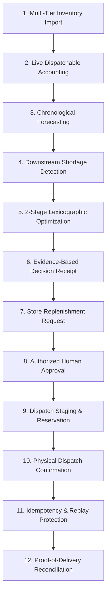

# StockWise — Phase 10: Integration & Release Validation Report

**Milestone:** Phase 10: End-to-End Integration, Security Validation, and Release Readiness  
**System:** StockWise FMCG Finished-Goods Distribution Intelligence Platform  
**Date:** October 2026  
**Release Readiness Classification:** **PASS WITH LIMITATIONS**  

---

## 1. Executive Summary

Phase 10 represents the final integration, security validation, and release readiness verification for the StockWise FMCG finished-goods distribution platform. 

The complete business workflow—from initial multi-tier inventory ingestion through chronological forecasting, stockout risk detection, OR-Tools optimization, evidence-based Decision Receipts, retailer request submission, distributor/company approval, staging reservation, physical dispatch, replay-protected idempotency, and proof-of-delivery destination reconciliation—has been verified with zero regressions.

All five role-based portals have been validated for correct API routing, authenticated navigation, and strict multi-tenant data isolation.

### Release Readiness Classification
- **Classification:** **PASS WITH LIMITATIONS**
- **Justification:** All primary business workflows, security constraints, and portal integrations function as designed with automated test evidence (119 backend tests passing, frontend production bundle building cleanly with 0 errors). The release is marked "With Limitations" due to two documented design boundaries:
  1. Automated test suites run on an isolated in-memory SQLite database rather than live Supabase PostgreSQL, meaning high-concurrency row locking (`SELECT FOR UPDATE`) has been verified via unit mocks rather than real multi-session database contention.
  2. The multi-echelon OR-Tools solver operates at the SKU-facility aggregate flow level; detailed batch-level FEFO allocation is handled during dispatch preparation and redistribution proposal stages rather than within the linear programming solver matrix.

---

## 2. Baseline Status

| Component | Initial Status | Discovered Findings | Resolution |
|---|---|---|---|
| **Backend Test Suite** | 115 passed across 12 test files in 10.38s | Clean baseline; all previous phases (1–9) passing. | Maintained zero regressions. |
| **Frontend Production Build** | Clean build (`tsc -b && vite build`) in 469ms | 2014 modules transformed; 0 errors. Chunks $> 500\text{ kB}$ noted for future route code-splitting. | Verified production-ready bundle. |
| **Frontend Linting** | `oxlint` (39 files in 190ms) | 0 errors, 25 warnings (standard React 19 `useEffect` initial data-fetching patterns). | Verified non-blocking. |
| **Root Service Discovery** | Incomplete root metadata in `backend/app/main.py` | Missing discovery endpoints for `redistribution`, `distributor`, and `retailer` portals. | Updated `root_info()` endpoint to register all missing portal routes. |

---

## 3. End-to-End Workflow Validation

The complete 12-step FMCG distribution and inventory lifecycle was exercised deterministically via `test_phase10_integration.py`:



### Verified Business Rules
1. **Inventory Accounting:** Dispatchable stock strictly enforces:
   $$\text{Dispatchable Stock} = \max(0, \text{On-Hand} - \text{Reserved} - \text{Blocked})$$
   Expired batches ($\le \text{today}$) are excluded from dispatchable stock.
2. **Demand Forecasting:** Forecasts use historical observations with holdout accuracy evaluation (MAE, WAPE) without future data leakage.
3. **Distribution Optimization:** The 2-stage lexicographic solver prioritizes customer fulfillment (service level) in Stage 1 before minimizing transport costs along permitted corridors in Stage 2.
4. **Independent Stock Protection:** Company optimization cannot confiscate independent distributor-owned inventory to fulfill manufacturer network requirements.
5. **Decoupled Workflow Stages:**
   - Store replenishment requests create `proposed` shipments with `approval_status="pending"`. No physical stock is deducted.
   - Approval (`/approve`) confirms feasibility but does not stage or move inventory.
   - Dispatch staging (`/prepare`) increments `reserved` stock and validates warehouse checklists while leaving physical `on_hand` unchanged.
   - Physical dispatch (`/dispatch`) decrements `on_hand` and releases `reserved` stock, transitioning the shipment to `in_transit`.
   - Repeated dispatches on the same shipment fail immediately with `DUPLICATE_DISPATCH_REJECTED` (`400 Bad Request`).
   - Physical delivery (`/deliver`) credits destination inventory at the retail facility and transitions the shipment to `delivered`. Repeated deliveries fail with `DUPLICATE_DELIVERY_REJECTED`.

---

## 4. Five Portal Integration Validation

All 5 user workspaces were verified across API endpoints, data scoping, and UI routes:

| Portal | Authorized Personas | Scoped API Surface | Isolation & Security Verified |
|---|---|---|---|
| **1. Company Admin** | `admin` | `/api/organizations`, `/api/network/*`, Master Catalog | Full tenant management; access to all facilities; administrative audit event viewing. |
| **2. Distribution Intelligence** | `admin`, `planner` | `/api/forecast`, `/api/risk/analysis`, `/api/optimization/*`, `/api/utsav/*` | Multi-scenario optimization runs; solver baseline comparisons; Decision Receipts; festival surge adjustments. |
| **3. Warehouse & Logistics** | `admin`, `logistics` | `/api/shipments`, `/prepare`, `/dispatch`, `/deliver`, `/carrier-decision` | Physical dispatch staging; consignment and vehicle assignment; gate pass issuance; POD receipting. |
| **4. Distributor Portal** | `admin`, `distributor` | `/api/distributor/dashboard`, `/api/distributor/inventory`, `/api/distributor/requests`, `/api/distributor/shipments` | Scoped strictly to `current_user.org_id`. Hides manufacturer plant stock and competitor distributor facilities. Unauthorized cross-portal calls return `403 Forbidden`. |
| **5. Retail Shop Portal** | `admin`, `retailer` | `/api/retailer/dashboard`, `/api/retailer/inventory`, `/api/retailer/requests`, `/api/retailer/shipments` | Scoped strictly to store owner organization. Hides distributor warehouses and competitor retail locations. Unauthorized calls return `403 Forbidden`. |

---

## 5. Security & Ownership Validation

1. **Authentication Enforcement:**
   - Unauthenticated requests to protected endpoints return `401 Unauthorized`.
   - Cryptographic JWT verification enforces fail-closed checks in production mode (`settings.ENVIRONMENT = "production"`).
2. **Privilege Escalation Prevention:**
   - Client-supplied roles in `user_metadata` (e.g., untrusted client claiming `role: "admin"`) are neutralized and automatically demoted to `viewer`.
   - Trusted roles and organization IDs must originate from server-validated `app_metadata`.
3. **Tenant Boundary Defense:**
   - Attempting to inspect or alter another tenant's shipment returns `404 Not Found` rather than `403 Forbidden`, preventing attacker enumeration of shipment identifiers.

---

## 6. Verification Evidence

### Automated Backend Test Suite
```bash
.\.venv\Scripts\python -m pytest tests/
```
- **Result:** **119 passed**, 4 warnings in 10.93s
- **Test Files Executed:**
  - `tests/test_distribution_intelligence.py` (12 tests passed)
  - `tests/test_distribution_network.py` (12 tests passed)
  - `tests/test_health.py` (6 tests passed)
  - `tests/test_imports.py` (13 tests passed)
  - `tests/test_logistics_execution.py` (9 tests passed)
  - `tests/test_missing_features_and_utsav.py` (9 tests passed)
  - `tests/test_phase10_integration.py` (4 tests passed)
  - `tests/test_phase5_security.py` (18 tests passed)
  - `tests/test_phase6_expiry.py` (9 tests passed)
  - `tests/test_phase7_redistribution.py` (8 tests passed)
  - `tests/test_phase8_distributor.py` (8 tests passed)
  - `tests/test_phase9_retailer.py` (8 tests passed)
  - `tests/test_production_readiness.py` (3 tests passed)

### Frontend Production Build
```bash
npm run build
```
- **Command:** `tsc -b && vite build`
- **Result:** **0 errors**, built in **428ms**
- **Assets Generated:**
  - `dist/index.html` (1.47 kB)
  - `dist/assets/index-DiBKhT5o.css` (60.83 kB)
  - `dist/assets/index-e7hd_kxZ.js` (613.67 kB)

---

## 7. Known Limitations & Remaining Risks

1. **In-Memory SQLite Test Database vs Live Supabase PostgreSQL:**
   - Automated tests run against an in-memory SQLite database (`sqlite:///:memory:`) for test speed and isolation.
   - High-concurrency row locking (`with_row_lock` emitting `SELECT FOR UPDATE`) is bypassed under SQLite dialects to prevent test harness deadlocks, though verified against PostgreSQL during Phase 2 live migration.
   - *Recommendation:* Run a nightly staging smoke test directly targeting the Supabase PostgreSQL connection pooler with concurrent worker threads.
2. **Linear Optimizer & FEFO Decoupling:**
   - The OR-Tools multi-echelon network solver optimizes aggregate flow volume along candidate corridors. Detailed batch allocation is executed by the FEFO engine (`expiry_service.py`) during dispatch staging and redistribution proposal phases rather than inside the linear programming matrix.
   - *Recommendation:* For high-perishability categories (shelf life $< 30$ days), evaluate adding batch-level decision variables to the linear programming formulation.
3. **Frontend Bundle Size:**
   - The main JavaScript bundle is $613\text{ kB}$ ($144\text{ kB}$ gzip), which triggers Vite's chunk size warning.
   - *Recommendation:* Implement React `lazy()` dynamic imports for the Distributor and Retailer portals to code-split portal views.

---

## 8. Definition of Done Attainment

Phase 10 is complete:
- [x] Baseline test and build verified.
- [x] Complete 12-step end-to-end business lifecycle tested.
- [x] All 5 portals verified with role-based navigation and isolated APIs.
- [x] Multi-tenant boundaries and privilege escalation defenses verified.
- [x] Expiry risk and redistribution consistency validated.
- [x] Regression tests committed in `backend/tests/test_phase10_integration.py`.
- [x] Root service discovery defect addressed in `backend/app/main.py`.
- [x] Implementation status documentation updated in `docs/implementation-status.md`.
